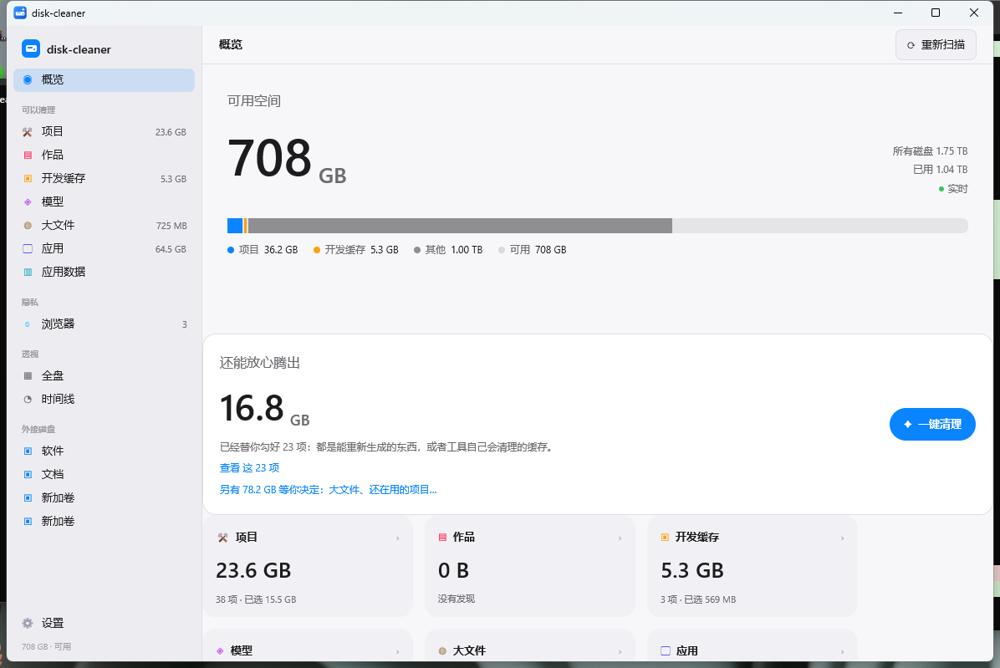

# disk-cleaner

> Windows 磁盘空间清理工具：先看清楚空间去了哪，再决定删什么。



`disk-cleaner` 使用 **Rust + [GPUI](https://github.com/zed-industries/zed/tree/main/crates/gpui)** 编写，界面与交互参考 macOS 应用 SuckMyDisk 的 Windows 重写实现。它会扫描本机所有本地磁盘，把空间去向整理成容量概览、Treemap 和分类清单；只推荐能重新生成或可以找回的内容，并在真正清理前逐项复核。

## 功能

- **全盘扫描**：一次扫描所有本地磁盘（自动跳过不可读、受保护的目录），多块盘合并成一棵目录树，可以按磁盘或目录逐层钻取。
- **容量概览**：可用空间、已用空间、各分类占用一目了然，实时显示扫描/清理后的变化。
- **Treemap 视图**：按面积直观展示大目录，支持面包屑导航和右键菜单。
- **九类智能识别**：
  - **项目** — 源码工程及其可重新生成的构建产物
  - **作品** — 照片、视频等创作素材
  - **开发缓存** — 各类包管理器 / 构建工具的缓存
  - **模型** — 本地 AI 模型权重
  - **应用** — 已安装应用及它们在用户目录里的数据
  - **应用数据** — AppData 中可清理的数据
  - **系统** — 系统产生的可回收内容
  - **大文件** — 不属于上述类别的大文件（安装包、镜像、压缩包等）
  - **浏览器** — 浏览器缓存
- **清理前复核**：每一项在执行前都会重新检查；受保护的文件永远不会被删除，正在使用的应用会被跳过。
- **可恢复优先**：
  - 缓存、构建产物等「能重新生成」的内容直接删除；
  - 你的文件（大文件、应用等）移入 **回收站**，随时可以放回；
  - 部分缓存通过工具自带的命令或官方数据库清理。
- **多选与清单**：每一项都可以单独勾选，「已选 N 项」面板集中查看即将清理的内容与释放空间。
- **时间线与历史**：记录每天的空闲空间变化和各类内容的变化明细。
- **搜索**：按文件名 / 路径实时过滤。
- **体验细节**：中英文界面、浅色 / 深色 / 跟随系统主题、设置持久化、平滑的 Treemap 与列表交互。
- **演示模式**：`--demo` 使用内置演示数据，不读取、不修改你磁盘上的任何文件。

## 构建与运行

要求：

- Windows 10 / 11
- Rust（MSVC 工具链，建议 1.75+）
- Visual Studio Build Tools + Windows SDK（嵌入图标资源需要 `rc.exe`）

```bash
# 调试构建
cargo build
.\target\debug\disk-cleaner.exe

# 发布构建
cargo build --release
.\target\release\disk-cleaner.exe

# 演示模式（不访问真实文件）
.\target\release\disk-cleaner.exe --demo
```

> 仓库里的 `.cargo/config.toml` 配置了 rsproxy 镜像源（国内加速）。如果你的网络可以直接访问 crates.io，可删除该文件或替换为默认源。

首次启动会自动开始一次全盘扫描（**只读**）。扫描期间界面仍可交互。

## 数据目录

运行数据保存在 `%APPDATA%\disk-cleaner\`：

| 文件 | 内容 |
| --- | --- |
| `report.json` | 最近一次扫描与识别结果 |
| `history.json` | 每日空间变化与分类变化历史 |
| `settings.json` | 主题、语言等偏好设置 |

从旧版本（目录名 `SuckMyDisk`）升级时，首次启动会自动迁移以上文件。

## 应用图标

图标为蓝色圆角磁贴 + 白色硬盘 + 闪光，包含 16–256px 共 10 个尺寸：

- 设计稿生成脚本：`tools/make-icon.ps1`
- 图标文件：`assets/disk-cleaner.ico`
- 通过 `build.rs` + [`embed-resource`](https://crates.io/crates/embed-resource) 以资源 ID 1 嵌入可执行文件，供标题栏 / 任务栏 / 文件资源管理器使用。

重新生成图标：

```powershell
powershell -ExecutionPolicy Bypass -File tools/make-icon.ps1
```

## 代码结构

| 路径 | 说明 |
| --- | --- |
| `src/main.rs` | 程序入口、窗口创建 |
| `src/ui.rs` | 全部界面与交互（概览、全盘、时间线、设置） |
| `src/scan.rs` | 多根目录扫描、目录树模型 |
| `src/recognize.rs` | 九类内容识别、项目活跃度分析 |
| `src/clean.rs` | 清理计划与执行（删除 / 回收站 / 工具命令） |
| `src/treemap.rs` | Treemap 布局算法 |
| `src/volume.rs` | 磁盘容量与本地卷枚举 |
| `src/history.rs` | 历史记录与数据目录 |
| `src/prefs.rs` / `src/theme.rs` | 偏好设置与主题 |
| `src/model.rs` / `src/apps.rs` | 数据模型、已安装应用枚举 |
| `app.rc` / `build.rs` | Windows 图标与版本资源嵌入 |

## 安全说明

- 扫描过程只读；清理动作需要你显式勾选并确认。
- 用户文件优先移入回收站；删除操作前会再次校验路径，受保护目录一律拒绝。
- 清理会改变磁盘内容，重要数据请提前备份。
